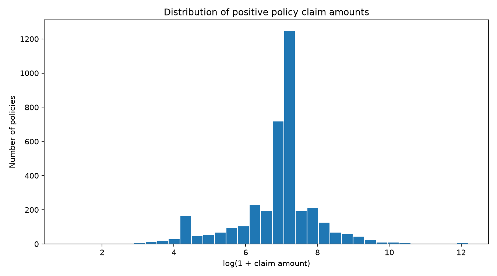
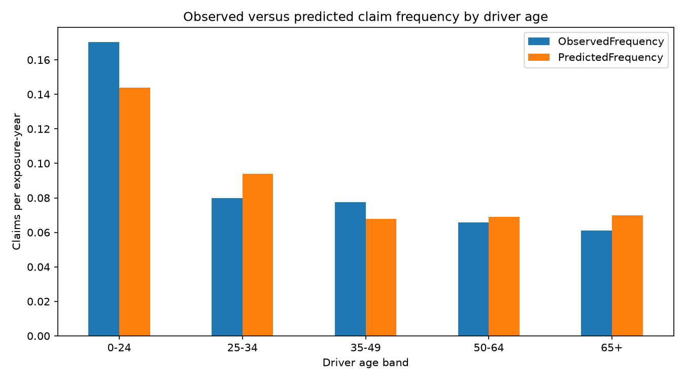

# Motor Insurance Pure Premium Modelling (Python)

## Overview

This analysis estimates expected motor insurance claim costs using separate claim frequency and severity models. The models are fitted to French motor third-party liability claims data and evaluated on a held-out sample. The objective is to understand how policy characteristics relate to claim experience and assess the accuracy of an interpretable frequency–severity pricing framework.

## Dataset and Preparation

The analysis joins the following publicly available datasets by policy identifier (`IDpol`):

- [freMTPL2freq](https://www.openml.org/d/41214): policy exposure, claim counts and policy characteristics.
- [freMTPL2sev](https://www.openml.org/d/41215): claim amounts, aggregated to the policy level.

The selected predictors are driver age (`DrivAge`), vehicle age (`VehAge`), bonus–malus (`BonusMalus`), fuel type (`VehGas`), and area (`Area`).

| Data-processing measure | Policies |
| --- | ---: |
| Original policies | 678,013 |
| Policies retained after cleaning | 668,897 |
| Records excluded during cleaning | 9,116 |
| Policies selected for modelling | 100,000 |
| Training set | 75,000 |
| Test set | 25,000 |

Invalid or missing key observations and inconsistencies between positive claim counts and positive paid amounts are excluded. Exposure is capped at one year, claim count at four, and total policy claims cost at 200,000. These are explicit modelling choices and can affect the results. A random sample and train/test split are selected with seed 42.

## Methodology

**Frequency:** A Poisson generalized linear model estimates claim count per exposure-year. Policies are weighted by their observed exposure. 

**Severity:** A Gamma generalized linear model estimates positive mean paid claim amount, using claim count as the sample weight when modelling the average amount per claim for each policy.

**Pure premium:** The estimates are combined to obtain expected annual claims cost:

$$
\widehat{\text{Pure Premium}}_i =
\widehat{\text{Claim Frequency}}_i \times
\widehat{\text{Claim Severity}}_i
$$

Predicted cost over the observed policy period equals estimated annual pure premium multiplied by exposure. The model uses a 75% training and 25% test split, with numerical predictors standardised and categorical variables one-hot encoded.

## Results

### Test-set performance

| Measure | Observed | Predicted |
| --- | ---: | ---: |
| Total claim cost (dataset monetary units) | 2,149,454.65 | 1,927,937.56 |
| Claim frequency (claims/exposure-year) | 0.0756 | 0.0759 |
| Annual claims cost per exposure-year | 161.41 | 144.78 |

**Predicted-to-observed aggregate claim cost ratio: 0.897.** Predicted total costs are approximately 10.3% below observed costs on the test set, a shortfall of 221,517.09 monetary units.

Overall claim frequency is close to the observed rate. Nevertheless, the estimated total claims cost is lower than observed. This difference highlights why frequency calibration alone does not establish pricing accuracy: claim severity, the mix of risks and the interaction of the two predictions also matter.

### Positive policy claim amounts

Positive policy-level claim amounts vary over a wide range, with a small number of much larger amounts. The histogram uses `log(1 + claim amount)` to make differences across magnitudes easier to see. The noticeable peak at particular transformed amounts warrants further investigation; the chart alone does not establish its cause.

### Observed versus predicted frequency by driver age

| Driver age band | Observed claims/exposure-year | Predicted claims/exposure-year |
| --- | ---: | ---: |
| 0-24 | 0.1703 | 0.1438 |
| 25-34 | 0.0798 | 0.0941 |
| 35-49 | 0.0774 | 0.0679 |
| 50-64 | 0.0657 | 0.0689 |
| 65+ | 0.0609 | 0.0697 |

The youngest age band (0–24) has the highest observed frequency, and the model underpredicts its claim frequency. The model also underpredicts ages 35–49, while overpredicting ages 25–34 and 65+. This demonstrates that a good overall frequency estimate can still mask differences between customer groups.

## Conclusions

- The Poisson–Gamma frequency–severity framework provides an interpretable estimate of annual pure premiums using policyholder and vehicle characteristics.
- Although overall claim-frequency calibration is close on the held-out sample, aggregate claims cost is underestimated. Future development should investigate severity fit, large losses, and variation in model performance across risk groups.
- Driver age is associated with clear differences in observed claim frequency. The largest deviation between predicted and observed rates occurs in the youngest age band in this analysis.
- More detailed validation is needed before using the estimates for commercial decisions. The calculated pure premiums exclude expenses, profit margins, reinsurance costs, taxes and other pricing adjustments.

## Limitations

- Capping claim amounts, claim counts and exposure and excluding inconsistent records change the underlying claims experience, potentially biasing estimates.
- Results depend on a randomly selected 100,000-policy sample and a random train/test split; a later-period holdout was not assessed.
- The predictors are deliberately limited. Nonlinear effects, interactions and broader model diagnostics have not been comprehensively tested.
- Aggregate predicted-to-observed cost is only one calibration measure and does not determine whether premiums are appropriate for every subgroup.
- No separate extreme-loss treatment or inflation adjustment has been implemented.

## Repository Files

| File | Description |
| --- | --- |
| `motor_pricing.py` | Data preparation, Poisson frequency model, Gamma severity model and model evaluation |
| `requirements.txt` | Python library dependencies |
| `results/data_quality.csv` | Record counts before and after cleaning and sampling |
| `results/model_performance.csv` | Observed and predicted aggregate metrics on the held-out sample |
| `results/frequency_by_age.csv` | Observed and predicted frequency by driver age band |
| `results/sample_predictions.csv` | Example policy-level predictions for the test set |
| `results/claim_amount_distribution.png` | Distribution of positive policy claim amounts |
| `results/frequency_by_driver_age.png` | Age-band frequency comparison |

## References

- [OpenML: freMTPL2freq](https://www.openml.org/d/41214)
- [OpenML: freMTPL2sev](https://www.openml.org/d/41215)
- [scikit-learn: Tweedie regression on insurance claims](https://scikit-learn.org/stable/auto_examples/linear_model/plot_tweedie_regression_insurance_claims.html) — modelling background for frequency–severity regression.
